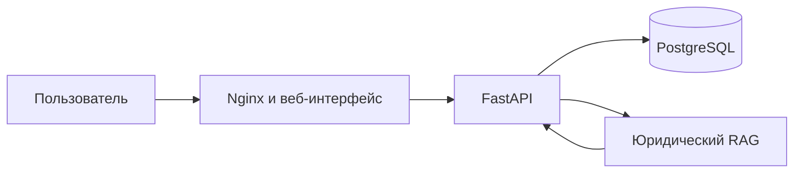
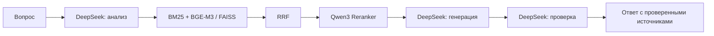

<div align="center">

# Юридический ИИ-ассистент

Локальное приложение для поиска по юридическому корпусу, подготовки ответа и показа проверяемых фрагментов первоисточника.

**Приложение**

  

**Поиск и модели**

    

**Инфраструктура**

  

[Возможности](#возможности) · [Архитектура](#архитектура) · [Быстрый запуск](#быстрый-запуск) · [Проверка](#проверка-работоспособности) · [Документация](#документация-и-разработка)

</div>

## Возможности

- Хранит диалоги, ответы и сохранённые позиции источников в PostgreSQL.
- Ищет по BM25 и BGE-M3/FAISS, затем объединяет кандидаты через RRF.
- Переранжирует найденные фрагменты локальным Qwen3 Reranker.
- Выполняет анализ, генерацию и проверку через DeepSeek с температурой `0.3`.
- Не публикует утверждение без подтверждённого фрагмента документа.

## Архитектура





PostgreSQL хранит пользователей, диалоги, сообщения, ответы и диапазоны источников. Смысловой канал использует предварительно построенный FAISS-индекс из `submission/assets/bge_m3`; BM25 строится по тому же корпусу. Backend принимает только строгий `CoreResult`, в котором каждая публичная ссылка сопоставлена с каноническим текстом документа.

## Быстрый запуск

Требуются Git и Docker Desktop с Docker Compose. Создайте локальный файл окружения; `.env` не должен попадать в Git.

### Windows PowerShell

```powershell
Copy-Item .env.example .env
docker compose -f docker-compose.yml -f integration/docker-compose.rag.yml -f integration/docker-compose.models.yml up -d --build
```

### Linux

```bash
cp .env.example .env
docker compose -f docker-compose.yml -f integration/docker-compose.rag.yml -f integration/docker-compose.models.yml up -d --build
```

Заполните в `.env` как минимум `POSTGRES_PASSWORD`, `APP_USER_LOGIN`, `APP_USER_PASSWORD` и ключ DeepSeek `LLM_DEV`. Рабочий RAG доступен по адресам:

- веб-интерфейс — <http://localhost:8082>;
- API — <http://localhost:8001>;
- Swagger UI — <http://localhost:8001/docs>;
- readiness RAG — <http://localhost:8001/integration/readyz>.

Базовый `docker compose up -d --build` запускает только Nginx, FastAPI и PostgreSQL. Для юридических ответов используйте RAG-overlay, показанный выше.

## NVIDIA CUDA и CPU

CPU-запуск использует `integration/docker-compose.models.yml`. Для NVIDIA GPU добавьте CUDA-overlay:

```powershell
docker compose -f docker-compose.yml -f integration/docker-compose.rag.yml -f integration/docker-compose.models.yml -f integration/docker-compose.models.cuda.yml up -d --build
```

Для Linux применяется та же команда. Нужны NVIDIA Driver, NVIDIA Container Toolkit и работающая команда `docker run --rm --gpus all nvidia/cuda:12.4.1-base-ubuntu22.04 nvidia-smi`.

Веса BGE-M3 и Qwen3 сохраняются в именованных Docker volumes и повторно не скачиваются при обычном перезапуске. Если модели уже запущены отдельно на Windows, задайте `EMBEDDER_BASE_URL=http://host.docker.internal:8081/v1` и `RERANKER_BASE_URL=http://host.docker.internal:8080/v1`; адрес `127.0.0.1` внутри Backend-контейнера указывает на сам контейнер.

CUDA-overlay оставляет llama.cpp автоматически подбирать число слоёв Qwen3 в VRAM с резервом 512 MiB. Это важно для видеокарт на 4 ГБ, где BGE-M3 и reranker используют GPU одновременно.

## Переменные окружения

| Переменная | Назначение |
| --- | --- |
| `POSTGRES_DB`, `POSTGRES_USER`, `POSTGRES_PASSWORD` | База и прикладная роль PostgreSQL |
| `APP_USER_LOGIN`, `APP_USER_PASSWORD` | Локальная учётная запись веб-приложения |
| `API_PORT`, `FRONTEND_PORT` | Публикуемые порты API и интерфейса |
| `LLM_BASE_URL`, `LLM_DEV`, `LLM_MODEL` | Endpoint, ключ и модель DeepSeek |
| `TEMPERATURE` | Температура рабочих вызовов DeepSeek; должна быть `0.3` |
| `EMBEDDER_BASE_URL`, `EMB_MODEL`, `EMBEDDER_API_KEY` | BGE-M3 embeddings API |
| `RERANKER_BASE_URL`, `RERANKER_MODEL`, `RERANKER_API_KEY` | Qwen3 reranker API |
| `TOP_K`, `RERANKER_TOP_N` | Размеры поисковой и финальной выборок |
| `RAG_MODEL_TIMEOUT_SECONDS` | Максимум одного сетевого вызова модели |
| `RAG_REQUEST_TIMEOUT_SECONDS` | Общий бюджет Backend-запроса, меньший proxy timeout |

`CORPUS_ID` и `INDEX_GENERATION_ID` при RAG-запуске вычисляются из корпуса и manifest индекса. Значения секретов не выводятся в логи и документацию.

## Проверка работоспособности

```powershell
docker compose -f docker-compose.yml -f integration/docker-compose.rag.yml -f integration/docker-compose.models.yml ps
Invoke-RestMethod http://localhost:8001/healthz
Invoke-RestMethod http://localhost:8001/integration/readyz | ConvertTo-Json -Depth 6
```

В `dependencies` readiness должны быть `ready: true` для `index`, `bge_m3`, `qwen3` и `deepseek`. Затем войдите в интерфейс, создайте диалог, отправьте вопрос и откройте карточку источника. Полная проверка считается успешной, только если ответ содержит проверенные источники, диалог сохранён после обновления страницы, а открытый документ показывает непустой выделенный фрагмент.

Диагностика:

```powershell
docker compose -f docker-compose.yml -f integration/docker-compose.rag.yml -f integration/docker-compose.models.yml logs --tail 200 api bge-m3 qwen3-reranker
docker stats --no-stream
nvidia-smi
```

Техническая недоступность обязательной модели возвращается как HTTP `503`, а исчерпание общего бюджета обрабатывается Backend до истечения 360-секундного timeout Nginx. Это не подменяется юридическим ответом «недостаточно доказательств».

Остановка без удаления PostgreSQL, индексов и весов:

```powershell
docker compose -f docker-compose.yml -f integration/docker-compose.rag.yml -f integration/docker-compose.models.yml stop
```

## Структура репозитория

| Каталог | Назначение |
| --- | --- |
| `backend/` | FastAPI, аутентификация и хранение диалогов/источников |
| `frontend/` | Статический веб-интерфейс и конфигурация Nginx |
| `integration/` | Подключение конкурсного RAG к Backend и Compose-overlays |
| `core/` | Доменные контракты юридического конвейера |
| `submission/` | BM25/FAISS, модели, генерация, проверка и конкурсный CLI |
| `tests/` | Контрактные, регрессионные и Golden-тесты |
| `docs/` | Архитектурные и API-контракты |
| `docs/reports/` | Зафиксированные отчёты и метрики прогонов |

## Документация и разработка

- [Архитектурный контракт](docs/ARCHITECTURE.md)
- [Описание API](docs/api.md)
- [Интеграция RAG](integration/README.md)
- [Правила агентов](.agents) и [краткая памятка](AGENTS.md)
- [История изменений](CHANGELOG.md)

```powershell
poetry install
poetry run python -m compileall core submission integration
poetry run pytest
```

Зависимости зафиксированы в `pyproject.toml` и `poetry.lock`. Логика RAG не содержит ответов или специальных порогов для известных вопросов Golden Dataset.
