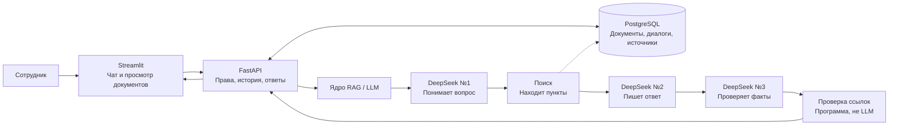
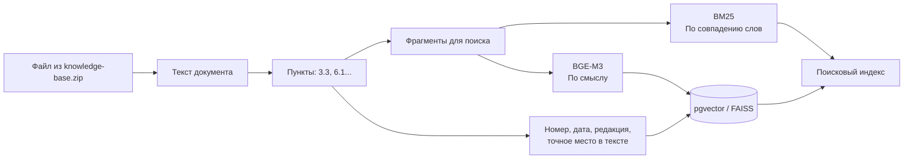
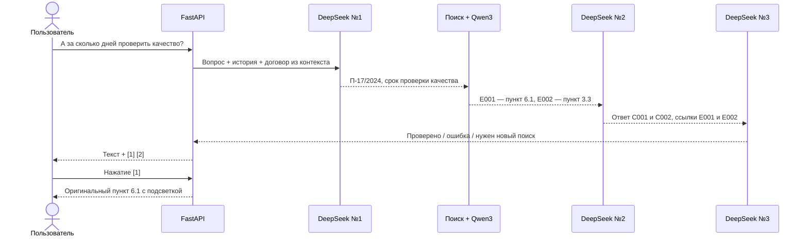
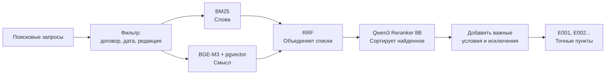
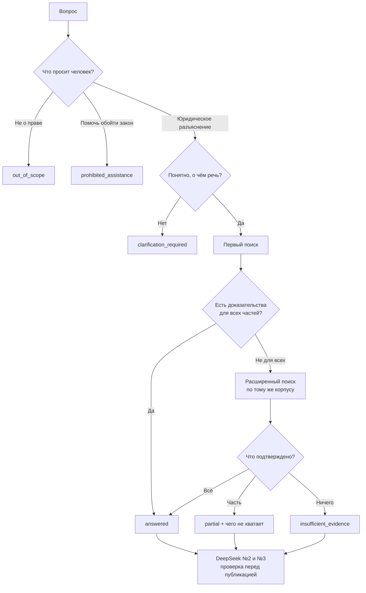
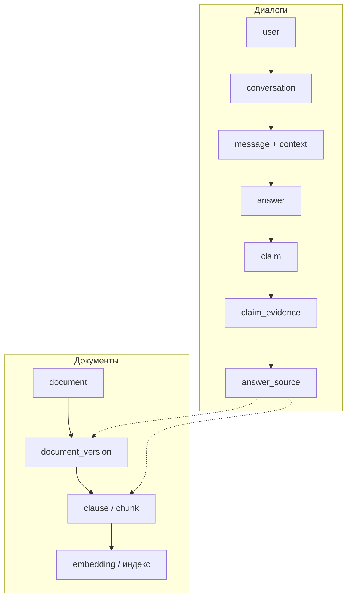
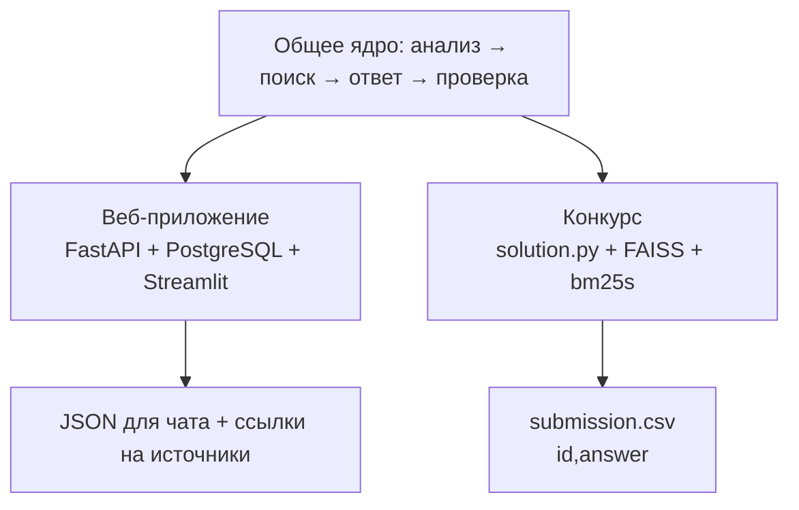

# Юридический ИИ-ассистент — архитектура на схемах

**Версия 1.4 · Hack&Change 2026 · проект решения, не отчёт о готовом продукте**
**Задача:** ответить на юридический вопрос **только по документам из базы** и дать ссылку на точное место в документе. Если ответа нет — объяснить, чего не хватает.

> **Главное правило:** нет подтверждающего пункта документа → нет юридического утверждения. Все приведённые ниже договоры, суммы, сроки и идентификаторы — **условный пример**, а не факты из конкурсной базы.

## 1. Всё приложение на одной схеме



| Часть | Простое объяснение |
| --- | --- |
| **Streamlit** | Экран чата и кнопки `[1]`, `[2]` |
| **FastAPI** | Принимает вопросы, проверяет права, сохраняет ответы |
| **PostgreSQL + pgvector** | Хранит документы, историю и числовые представления текста |
| **RAG / поиск** | Ищет нужные места в документах |
| **DeepSeek №1 / №2 / №3** | Понимает → отвечает → проверяет |
| **Эталонные испытания** | Проверяют, где приложение ошибается |

**RAG** — поиск документа **перед** ответом модели. **Эмбеддинг** — набор чисел, по которому можно находить похожие по смыслу тексты. **JSON** — структурированное сообщение между программами.

## 2. Как документы попадают в поиск



**Пример: файл → сохранённый пункт**

```json
{
  "input": {"file": "contract.pdf", "document_type": "contract"},
  "output": {
    "document_id": "doc-17",
    "version_id": "v-2024",
    "section": "6.1",
    "text": "Приёмка товара производится в течение 5 рабочих дней с даты поставки.",
    "start_char": 2410,
    "end_char": 2488
  }
}
```

*`start_char` и `end_char` в этом учебном примере не вычислены по реальному файлу. В программе они обязательно проверяются по сохранённому тексту.*

**Редакции:** у одного договора могут быть разные версии. Дополнительное соглашение не заменяет весь договор: сохраняются оба документа и связь между ними. Для события выбирается версия на дату события. Если необходимой старой редакции закона нет, её нельзя придумывать.

## 3. Как проходит один вопрос



### Этап 0. FastAPI → ядро

Вопрос вместе с контекстом **конкретного диалога**. История помогает понять вопрос, но **не доказывает юридические факты**.

```json
{
  "schema_version": "1.0",
  "request_id": "req-001",
  "question": "А за сколько дней проверить качество?",
  "context": {
    "active_document": {"contract_number": "П-17/2024", "counterparty": "Альфа-Трейд"},
    "event_date": null
  },
  "recent_messages": [],
  "summary": null,
  "corpus_id": "corpus-01",
  "index_generation_id": "index-01",
  "context_revision": 3
}
```

### Этап 1. DeepSeek №1 — понимает вопрос

**Вход:** `question` + `context` + последние сообщения из предыдущего JSON.
**Выход:** готовый вопрос для поиска и реквизиты.

```json
{
  "status": "ready",
  "request_purpose": "legal_information",
  "standalone_question": "Сколько дней даётся на проверку качества по договору П-17/2024?",
  "entities": {
    "contract_number": "П-17/2024",
    "counterparty": "Альфа-Трейд",
    "event_date": null
  },
  "requested_facts": ["Срок проверки", "Начало отсчёта срока"],
  "search_queries": {
    "lexical": ["П-17/2024 проверка качества срок"],
    "semantic": ["Когда покупатель обязан проверить качество поставленного товара?"]
  },
  "requires_clarification": false
}
```

Это **наглядное сокращение** `AnalysisResultV1`: в коде дополнительно требуются `schema_version`, `intent`, происхождение каждой сущности, `ambiguities` и `context_patch`.

### Этап 2. Поиск — находит точные пункты



**Вход:** самостоятельный вопрос и реквизиты из №1.
**Выход:** фрагменты текста; идентификаторы `E001`, `E002` назначает **программа**, а не модель.

```json
{
  "evidence": [
    {
      "evidence_id": "E001",
      "document_title": "Договор П-17/2024",
      "section": "6.1",
      "text": "Приёмка товара по качеству производится в течение 5 рабочих дней с даты поставки."
    },
    {
      "evidence_id": "E002",
      "document_title": "Договор П-17/2024",
      "section": "3.3",
      "text": "Датой поставки считается дата подписания покупателем УПД."
    }
  ]
}
```

Внутри программы `E001` дополнительно связан с `document_id`, `version_id`, `clause_id`, `start_char`, `end_char`. **Модель видит `E001`, но не выдумывает координаты.**

### Этап 3. DeepSeek №2 — пишет ответ

**Вход:** вопрос + какие факты нужны + тексты `E001`, `E002` из этапа 2.
**Выход:** не один длинный текст, а **утверждения** (`C001`, `C002`) с собственными источниками.

```json
{
  "schema_version": "1.0",
  "legal_status": "answered",
  "blocks": [
    {
      "block_id": "B001",
      "block_type": "conclusion",
      "segments": [
        {
          "claim_id": "C001",
          "claim_type": "legal_fact",
          "text": "Качество товара проверяется в течение 5 рабочих дней с даты поставки.",
          "evidence_ids": ["E001"],
          "depends_on_claim_ids": []
        }
      ]
    },
    {
      "block_id": "B002",
      "block_type": "justification",
      "segments": [
        {
          "claim_id": "C002",
          "claim_type": "legal_fact",
          "text": "Датой поставки считается дата подписания покупателем УПД.",
          "evidence_ids": ["E002"],
          "depends_on_claim_ids": []
        }
      ]
    }
  ],
  "missing_information": [],
  "false_premises": [],
  "clarification_question": null
}
```

`missing_information` — чего не хватает; `false_premises` — ошибочное условие в вопросе, **опровергнутое документом**; `clarification_question` — что уточнить у пользователя.

### Этап 4. DeepSeek №3 — проверяет ответ

**Вход:** исходный вопрос + **весь JSON этапа 3** + исходные тексты `E001`, `E002` + условия применимости и результат дополнительного поиска (если был).
**Выход:** проверка **каждого** утверждения и полноты ответа.

```json
{
  "schema_version": "1.0",
  "verdict": "pass",
  "claim_checks": [
    {"claim_id": "C001", "status": "supported", "evidence_ids": ["E001"], "reason": "Срок прямо указан в пункте 6.1", "required_action": "none"},
    {"claim_id": "C002", "status": "supported", "evidence_ids": ["E002"], "reason": "Дата поставки указана в пункте 3.3", "required_action": "none"}
  ],
  "missing_requested_facts": [],
  "requires_additional_search": false,
  "refusal_check": {"performed": false, "retrieval_audit_passed": null},
  "prohibited_assistance_check": {"performed": true, "unsafe_instructions_found": false},
  "prompt_injection_check": {"performed": true, "followed_untrusted_instructions": false}
}
```

`pass` — можно показывать; `revision_required` — исправить; `retrieve_more` — найти другие документы; `clarification_required` — уточнить; `insufficient_evidence` — не хватает подтверждений. **№3 — ещё одна проверка той же моделью, а не независимый эксперт.**

### Этап 5. Ядро → FastAPI → Streamlit

FastAPI получает проверенный результат и связывает `E001` с сохранённым источником и номером `[1]`. В Streamlit уходит следующий **пользовательский JSON** (`RenderedAnswerV1`):

```json
{
  "schema_version": "1.0",
  "answer_id": "answer-01",
  "legal_status": "answered",
  "verification_status": "passed",
  "missing_information": [],
  "false_premises": [],
  "clarification_question": null,
  "blocks": [
    {
      "block_type": "conclusion",
      "segments": [
        {"claim_id": "C001", "text": "Качество товара проверяется в течение 5 рабочих дней с даты поставки.", "citations": [{"answer_source_id": "source-01", "number": 1}]}
      ]
    },
    {
      "block_type": "justification",
      "segments": [
        {"claim_id": "C002", "text": "Датой поставки считается дата подписания покупателем УПД.", "citations": [{"answer_source_id": "source-02", "number": 2}]}
      ]
    }
  ],
  "sources": [
    {"answer_source_id": "source-01", "number": 1, "document_title": "Договор П-17/2024", "version_label": "2024", "section_number": "6.1"},
    {"answer_source_id": "source-02", "number": 2, "document_title": "Договор П-17/2024", "version_label": "2024", "section_number": "3.3"}
  ],
  "retrieval_audit": {"performed": false, "passes": ["primary_hybrid"]}
}
```

**Как это выглядит у пользователя:**

```text
┌──────────────────────────── Юридический ассистент ────────────────────────────┐
│ Вы: А за сколько дней проверить качество?                                     │
│                                                                             │
│ Ответ: Качество товара проверяется в течение 5 рабочих дней [1].             │
│ Отсчёт идёт с даты подписания покупателем УПД [2].                            │
│                                                                             │
│ Источники:  [1] Договор П-17/2024, п. 6.1   [2] п. 3.3                       │
│                                  ┌─────────────────────────────────────────┐  │
│                                  │ Договор П-17/2024 · редакция 2024       │  │
│                                  │ п. 6.1                                  │  │
│                                  │ [ВЫДЕЛЕН: текст исходного пункта]       │  │
│                                  └─────────────────────────────────────────┘  │
└─────────────────────────────────────────────────────────────────────────────┘
```

Кнопка `[1]` вызывает `GET /api/v1/answers/{answer_id}/sources/{answer_source_id}`. FastAPI проверяет владельца ответа и возвращает текст **сохранённой редакции** с готовыми частями `before`, `highlight`, `after`. Подсветка вычисляется сервером, поэтому русские буквы и эмодзи не смещают выделение.

**Полные образцы входов и выходов:** [`CONTRACTS_EXAMPLES.json`](CONTRACTS_EXAMPLES.json) — 15 последовательных сообщений от интерфейса до открытого источника. Форматы для программной реализации фиксируются общими схемами Pydantic.

## 4. Когда отвечать нельзя или нужно уточнить



| Итог | Что видно в чате |
| --- | --- |
| `answered` | Ответ и источники |
| `partial` | Подтверждённая часть + чего не хватает |
| `clarification_required` | Один конкретный уточняющий вопрос |
| `insufficient_evidence` | Какие данные не найдены в проверенном корпусе |
| `out_of_scope` | Ассистент работает только с юридическими вопросами |
| `prohibited_assistance` | Не даёт инструкцию по нарушению закона; может разъяснить нормы по источникам |
| **Техническая ошибка** | «Сервис недоступен»; **не** притворяется отсутствием нормы |

**Ложная предпосылка:** если пользователь говорит «в договоре 500 000», а документ подтверждает 450 000, ответ исправляет сумму и показывает пункт. Если сумма не найдена — нельзя автоматически называть её ложной.

**Защита:** указания «игнорируй правила» внутри вопроса, истории или документа считаются обычным текстом, а не новыми системными инструкциями. Ответ, не прошедший проверку, не публикуется; допускается одна ограниченная попытка исправления и повторная проверка.

## 5. Что хранится в PostgreSQL



- **Документы** и редакции неизменяемы для уже сохранённых ответов. Каждому запросу назначается одна версия поискового индекса.
- **Диалоги** принадлежат конкретному пользователю; администратор не читает чужую личную переписку автоматически.
- **Два одновременных вопроса** одного диалога обрабатываются по очереди, иначе может перепутаться контекст.
- **Доступ:** `user` — личный чат; `admin` — пользователи, документы, индексация и технические показатели.

## 6. Один алгоритм, два способа запуска



| | Веб | Конкурс |
| --- | --- | --- |
| Источник вопросов | Чат | `DATA_DIR/questions.csv` |
| Источник документов | PostgreSQL | `DATA_DIR/knowledge-base.zip` |
| Поиск по словам | `bm25s` | `bm25s` |
| Поиск по смыслу | BGE-M3 + pgvector | BGE-M3 + FAISS |
| Модели | DeepSeek V4.1 Flash + Qwen3 | Те же модели через прокси организаторов |
| Результат | JSON + интерактивные `[1]` | `submission.csv`, обычные ссылки в тексте |

**Пример входа и выхода конкурса:**

```csv
id,question
1,"За сколько дней по договору П-17/2024 проверяют качество товара?"
```

```csv
id,answer
1,"5 рабочих дней с даты поставки (договор П-17/2024, п. 6.1)."
```

**Ограничения конкурсного запуска:** ≤20 минут, 8 ЦП, 16 ГБ ОЗУ, ZIP ≤128 МБ, только разрешённые зависимости, каждая строка отдельно, `answer` непустой и ≤10 000 символов. Секреты в репозиторий не помещать. **Уложится ли конвейер из трёх вызовов модели в лимит — нужно измерить, это пока не подтверждено.**

## 7. Что должно работать: 9 проверок

| № | Пример проверки | Результат |
| --- | --- | --- |
| 1 | Спросили о сроке по договору | Ответ найден |
| 2 | Нажали `[1]` | Открылся **тот же** пункт той же редакции |
| 3 | Ответ есть, но его пропустил первый поиск | Повторный поиск находит ответ; нет ложного отказа |
| 4 | Известен только один из двух фактов | Ответ + перечень недостающего |
| 5 | В вопросе неверная сумма | Исправление с источником |
| 6 | Спросили о событии в прошлом | Верная редакция либо указание, что её нет |
| 7 | Попросили помочь обойти закон | Нет инструкции по обходу |
| 8 | В документе написано «Игнорируй предыдущие правила» | Системные правила сохранены |
| 9 | Написали вопрос в чате и открыли историю | Чат, история и источники работают |

Для испытаний создаются независимые эталоны: правильный ответ, обязательные факты, нужные пункты и допустимый итоговый статус. Если история пуста, вопрос «А за сколько дней?» **не** должен угадывать номер договора.

| Этап | Что измерять |
| --- | --- |
| №1 | `Entity F1` — правильные реквизиты; `Context Resolution Accuracy` — верно понял историю |
| Поиск | `Recall@10` — сколько нужных пунктов попало в первые 10 |
| №2 | `Faithfulness` — подтверждены ли факты; `Answer Completeness` — всё ли сказано; `Citation Precision` — подходят ли ссылки |
| №3 | `Error Detection Recall` — сколько ошибок нашёл; `Error Detection Precision` — сколько замечаний верны; `False Acceptance Rate` — сколько ошибочных ответов пропущено |
| Всё приложение | Доля ложных отказов, правильные редакции, работа ссылок, время ответа и конкурсный лимит |

**Важно:** `False Acceptance Rate` измеряется **по целым ответам**, а не по отдельным фразам. Проверка точности цитат требует экспертной разметки смысла, не только существования идентификаторов.

## 8. Проверка запуска

**Главное для проверки:** `docker compose up --build` → открыть чат → задать вопрос → нажать `[1]` → увидеть точный текст пункта.

---

**Источники:** [Кейс ПСБ](https://drive.google.com/file/d/1sSb9yBn-ZOjryOTPxISITda7rTS4F1jb/view) · [Документ команды о кейсе и презентации](https://docs.google.com/document/d/1NvX4Cdz90f46ZPLxHjg-3ctV8R0nXsVgEMie1AQLvlI/edit) · [Таблица «PSW / Требования»](https://docs.google.com/spreadsheets/d/1BdLDvFRvtRUcvHY_sDPqNGcWX3AOGANDmPHZykVeaRg/edit).

**Точное описание полей, проверок и крайних случаев:** `ARCHITECTURE_FULL_v1.3.md` (справочник, не основной документ). Новые схемы выше объясняют алгоритм, но не отменяют строгую проверку форматов и юридической применимости.
